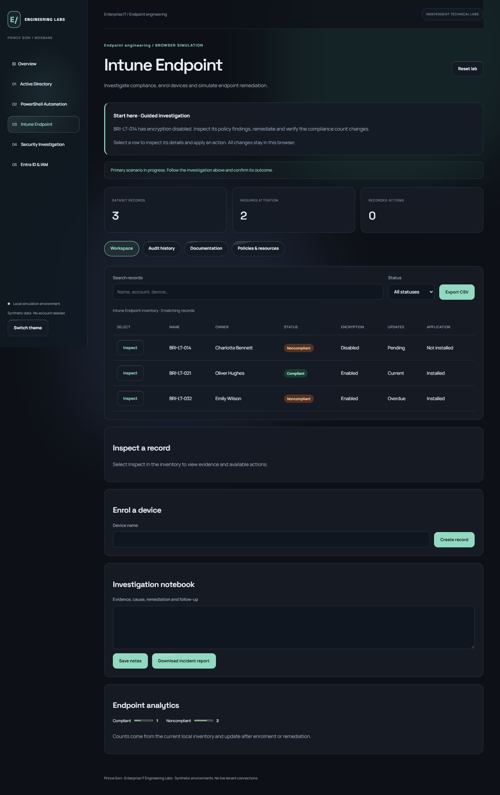

# Intune Endpoint

Investigate compliance, enrol devices and simulate endpoint remediation.

Independent technical simulation by Prince Soni. Synthetic Harbour Services data only.

## Technical objectives and features

BRI-LT-014 has encryption disabled. Inspect its policy findings, remediate and verify the compliance count changes.

Available actions: Remediate, Sync, Restart, Deploy application. Includes searchable inventory, status filters, audit history, CSV export, investigation notes, reset and local persistence.

## Technologies and architecture

Native JavaScript ES modules, semantic HTML, responsive CSS, Node.js tests. No dependencies.

Browser interface → pure simulation functions → localStorage. Data originates in shared/engine.js. No tenant, domain, SIEM or production backend. See [architecture](../documentation/ARCHITECTURE.md).

## Setup

Install Node.js 22 or newer. From the repository root run node server.mjs, then open http://127.0.0.1:4173/03-intune-endpoint-lab/. Run node build.mjs to prepare static files.

## Use and troubleshooting

Read the guided scenario, inspect the affected record, perform an action, confirm the changed evidence and review audit history. Save investigation notes before resolving incidents. Export CSV for reporting; reset restores the original dataset.

## Screenshots

 Thumbnail: [diagram](../assets/03-intune-endpoint-lab.svg).

## Technical scripts

See scripts/ for reviewable PowerShell examples and [command examples](../documentation/COMMANDS.md). These scripts are never executed by the browser.

## Testing

Run node --test from the repository root. See ../documentation/QA.md for executed results and limitations.

## Known limitations

This is a bounded technical demonstration, not a vendor product. Only listed actions are modelled. Browser storage is user-editable and not an audit security boundary. Production policy evaluation, permissions, network effects and replication are not modelled.

## Skills demonstrated

Microsoft Intune, Compliance, Windows; investigation, validation, reporting and state management.

## References

Microsoft Learn: https://learn.microsoft.com/powershell/ ; https://learn.microsoft.com/entra/ ; https://learn.microsoft.com/intune/ . Splunk Search Reference: https://docs.splunk.com/Documentation/Splunk/latest/SearchReference . Vendor names describe the subject; there is no vendor affiliation.

