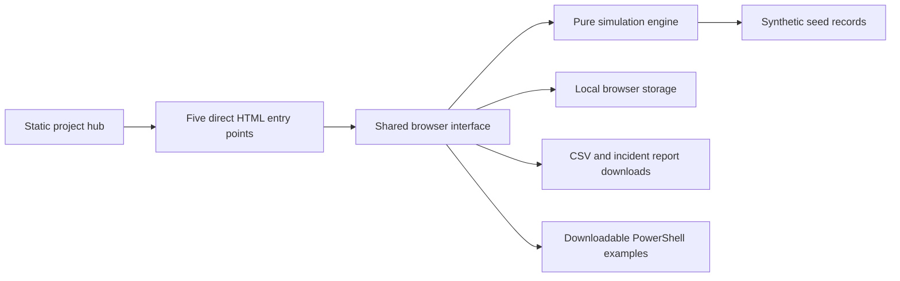

# Architecture

Native ES modules run without a package installation, remote fonts, telemetry, authentication or backend. A locally bundled MIT-licensed Lenis 1.3.27 helper supplies the same desktop wheel feel as the owner's portfolio; touch and reduced-motion modes remain native. Real directory or tenant integrations would require authentication, server-side authorization, protected storage and operational safeguards; they are deliberately outside this simulation.

Each lab uses a separate storage key. Mutations create a new state, update policy evidence and prepend an audit entry. Rendering escapes dynamic values. CSV exports neutralise formula prefixes. The narrow SPL parser rejects unsupported syntax; it never evaluates supplied code.

Folder routes contain actual index.html files, so GitHub Pages refresh and direct links work without rewrite rules. Relative URLs support a repository subpath. Build copies only public assets; private interview notes remain outside dist.
